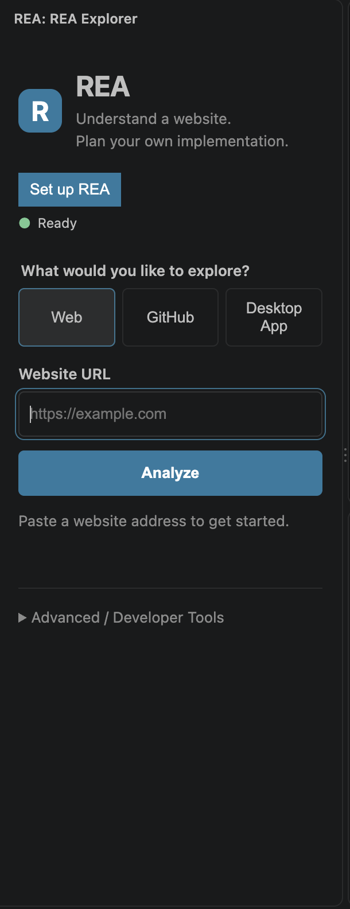
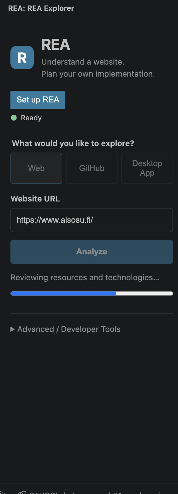
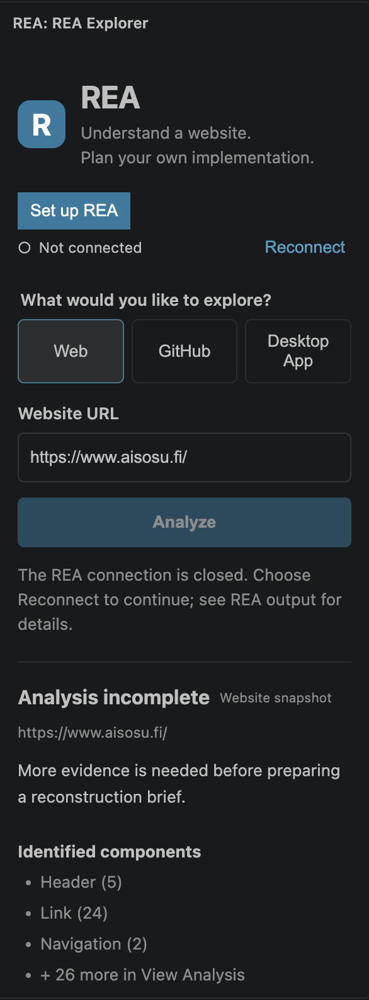
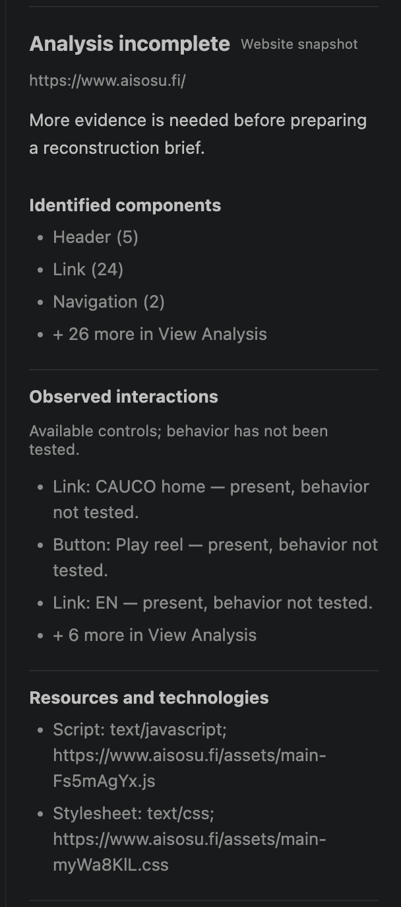

<div align="center">

# REA for VS Code

### Reverse engineering intelligence, inside your editor.

**Explore websites · Inspect repositories · Connect AI coding agents**

[](#release-status) [](#requirements) [](LICENSE) [](#ai-agent-integration)

**An independent CAUCOLabs project** · Built around the original [REA engine](https://github.com/morluto/rea) by **morluto**

[Overview](#overview) · [Features](#what-you-can-explore) · [Install](#quick-start) · [AI agents](#ai-agent-integration) · [Documentation](#documentation) · [Status](#release-status)

</div>

---

## Overview

**REA for VS Code** brings reverse-engineering workflows into a familiar development environment. Inspect a website, collect structured evidence, explore the architecture of a public GitHub repository, or connect an AI coding agent to the original REA engine through the **Model Context Protocol (MCP)**.

The extension provides a dedicated VS Code interface and bundles **REA 6.7.0** with an [integrity-checked native executable verification patch](patches/rea-6.7.0/README.md). The extension is independent of, and not endorsed by, the upstream REA maintainer.

<div align="center">
  
  <br />
  <sub>REA Explorer — one workspace for multiple analysis workflows.</sub>
</div>

## What you can explore

| Capability | What it does | Current status |
| :--- | :--- | :--- |
| **🌐 Web Analysis** | Inspect an HTTP(S) page in an isolated headless browser; capture page structure, links, resources and screenshots. Review evidence, export a report, and prepare reconstruction material. | Available; results depend on the site and successful completion of the analysis. |
| **🐙 GitHub Repository Analysis** | Collect a bounded, commit-pinned static snapshot of a public repository. Review file structure, languages, declared dependencies, configuration and architectural clues. | Implemented; subject to GitHub API limits and further release validation. |
| **🖥️ Desktop App Analysis** | Discover macOS applications and windows for native application inspection. | **Experimental**; the end-to-end UI workflow is not yet fully validated. |
| **🤖 MCP / AI agents** | Connect compatible agents to the bundled REA engine and discover its tool catalog. | MCP connectivity tested; individual tools and external providers are not all validated. |

### Web inspection, from request to evidence

The browser workflow separates what was **observed** from what has **not been tested**. A partial result should not be mistaken for a complete reconstruction specification.

<div align="center">
  
  <br />
  <sub>Live analysis progress.</sub>
</div>

<details>
<summary><strong>See example findings and partial-analysis behavior</strong></summary>
<br />

The example below captured page components and technical resources before the MCP connection closed. It is deliberately labeled **Analysis incomplete**; it does not demonstrate a successful end-to-end run.

<div align="center">
  
  <br /><br />
  
</div>

</details>

## Quick start

**No repository clone, npm installation or extension-development setup is needed to use a packaged VSIX.**

1. Obtain the VSIX matching your system from a distributor you trust: `darwin-arm64`, `darwin-x64`, `win32-x64`, or `linux-x64`.
2. In desktop **VS Code 1.102+**, open **Extensions → … → Install from VSIX…** and select the file. Reload if prompted.
3. Open a trusted workspace, select **REA** in the Activity Bar, and choose **Set up REA**.
4. Select **Verify connection** to perform an MCP handshake and discover the available tools.
5. Choose **Web**, **GitHub**, or **Desktop App** to explore the corresponding workflow.

Or install a downloaded package from a terminal:

```bash
code --install-extension /path/to/rea-vscode-0.4.0-<platform>.vsix
```

> **Distribution note:** Version 0.4.0 is a development milestone, not a claim of Marketplace publication or full production validation. Obtain VSIX files only from a trusted source.

## Requirements

- **VS Code:** Desktop version **1.102 or newer**; a trusted workspace is required for execution-related features.
- **Node.js:** The platform VSIX bundles **Node.js 26.8.1** and **REA 6.7.0**. A separate Node.js installation is normally unnecessary. A compatible system runtime (`^22.19.0 || ^24.11.0 || >=26.0.0`) can serve as a fallback.
- **Web analysis:** An installed **Google Chrome, Chromium, or Microsoft Edge** supporting the Chrome DevTools Protocol. REA does not download a browser.
- **AI agents:** Codex, Copilot, or another compatible MCP client is optional and must be installed/configured separately. Organizational policies can restrict MCP.
- **Optional analysis backends:** Tools such as Wireshark/tshark, Ghidra, and Hopper are not bundled or automatically installed. Optional Frida is excluded.

### Configuration

Use **REA: Set Up REA** to detect a browser or specify an executable path. Normal installation automatically selects the bundled engine and runtime.

| Setting | Purpose |
| :--- | :--- |
| `rea.executable` | Optional Node.js executable override or compatible system fallback. |
| `rea.scriptPath` | Optional absolute path to a custom `scripts/rea.mjs`; empty uses the bundled engine. |
| `rea.browserPath` | Optional absolute path to Chrome/Chromium/Edge; empty searches standard locations. |
| `rea.webOperationTimeoutMs` | Web discovery, inspection and screenshot timeout; default **60,000 ms**. |
| `rea.bundleAnalysisTimeoutMs` | Static script analysis timeout; default **300,000 ms**. |

Both timeout settings accept integer milliseconds from **1** to **3,600,000**. On macOS, select the browser binary inside `.app/Contents/MacOS`, not the `.app` directory.

**REA: Verify Installation** runs diagnostics and reconnects the engine. For failures, check **Output → REA**, workspace trust, runtime paths and browser availability. A successful connection does not prove every tool or provider works.

## AI agent integration

REA exposes its original engine over **MCP**, allowing compatible coding agents to discover tool schemas and request operations. The extension does not silently grant an agent permission to execute arbitrary tools.

### Codex

Run **REA: Configure Codex MCP** from the project used by Codex. The extension adds missing `[mcp_servers.rea]` and `[mcp_servers.rea_browser]` entries to that project's `.codex/config.toml`, using absolute paths to the installed runtime and engine. Existing definitions, comments, unrelated settings and credentials are preserved.

Restart the relevant Codex session or reload its VS Code window. If the extension is moved, upgraded or removed, review generated absolute paths: existing definitions are intentionally not overwritten automatically.

See [Codex browser lifecycle](docs/codex-browser.md) and [Codex MCP documentation](https://developers.openai.com/codex/mcp/).

### Copilot and VS Code MCP

Run **REA: Configure Copilot MCP** in a trusted local project. It creates or updates the workspace-root `.mcp.json` with the resolved engine executable while preserving unrelated entries. Start a new Copilot session associated with that workspace.

In **MCP: List Servers**, the extension also provides:

- **REA full engine** — the original tool catalog.
- **REA isolated browser** — managed browser acquisition and release.
- **REA Universal Tool Router** — `rea_search_tools`, `rea_get_tool_schema`, and `rea_execute_tool`.

Search and schema lookup do not execute REA operations. Router execution is marked as non-read-only/destructive so compatible clients can request approval. Tool behavior is still subject to the engine's own validation and external dependencies.

VS Code's MCP registry and a Copilot agent session are **separate integration paths**: registering a server in the editor does not by itself prove that an agent session can access it.

See [VS Code MCP integration](https://code.visualstudio.com/api/extension-guides/ai/mcp) and [MCP configuration formats](https://code.visualstudio.com/docs/agents/reference/mcp-configuration).

### Isolated browser companion

The bundled `rea_browser` companion offers `acquire_browser` and `release_browser`. Agents receive a temporary Chrome DevTools endpoint and allowed origins, gather evidence through the REA engine, then release their browser lease. Temporary browser profiles do not reuse a user's existing profile. Forced process termination may leave temporary resources behind.

## Reports and evidence

Web analysis can expose **View Analysis**, **Prepare Reconstruction**, and **Export Report**. Repository analysis can expose **View Analysis**, **Export Report**, and **Prepare Agent Handoff**. Outputs describe observed or statically inferred evidence; they do **not** recover the original source code or prove runtime behavior that was not tested.

Treat reports as potentially sensitive: they can contain data collected from the target. Review exported material before sharing it.

## Release status

> **0.4.0 — development / validation in progress**

The macOS arm64 package has undergone local checks and an MCP package smoke test. The GitHub analysis workflow encountered a GitHub API rate limit during a live test; that is not evidence of a completed repository-analysis run. The macOS Desktop App window-selection workflow still requires end-to-end correction and verification.

Other platform packages (`darwin-x64`, `win32-x64`, `linux-x64`) require their own CI matrix results and validation. Remote SSH, WSL, containers, VS Code for the Web and restricted browser environments are not verified. Tool discovery is **not** exhaustive validation of the engine's catalog.

The webview applies a Content Security Policy and renders tool output as untrusted content. Workspace Trust gates execution, but automatic disconnection on trust revocation is not guaranteed by the installed VS Code APIs.

## Documentation

| Guide | Contents |
| :--- | :--- |
| [GitHub repository analysis](docs/github-repository-analysis.md) | Static snapshot scope, evidence and limitations |
| [Agent integration verification](docs/agent-integration-verification.md) | Codex/Copilot checks and remaining validation |
| [Distribution and validation](docs/distribution-0.4.0.md) | Platform packaging and verification record |
| [Full engine access](docs/full-engine-access.md) | Engine catalog and advanced integration |
| [Web target analyzer](docs/web-target-analyzer.md) | Website inspection workflow |
| [Codex browser lifecycle](docs/codex-browser.md) | Browser lease management |
| [Connection lifecycle investigation](docs/connection-lifecycle-0.3.2.md) | Timeout behavior and diagnostics |

<details>
<summary><strong>Maintainers: build and package</strong></summary>

```bash
npm ci
npm run check
npm test
npm run build
git diff --check
npm run package
npm run verify:vsix
```

`npm run runtime:prepare -- --target <platform>` downloads and checksum-verifies the official Node runtime and installs locked production dependencies for the target. Native GitHub Actions runners build platform-specific VSIX files. The package checker validates archive contents and common secret/path patterns; it is **not** an exhaustive security audit.

</details>

## Credits and licensing

**REA for VS Code** — independent VS Code integration, interface, and browser lifecycle companion by **CAUCOLabs / CAUCO70**. MIT licensed; see [LICENSE](LICENSE). Copyright © 2026 CAUCO70 / CAUCOLabs.

**Original REA engine** — created by **morluto** and bundled **unchanged** under its MIT license. See the [upstream repository](https://github.com/morluto/rea), [LICENSE-REA](LICENSE-REA), and required dependency notices. This extension is **unofficial** and is not affiliated with or endorsed by the original maintainer.

Third-party JavaScript notices are in [THIRD_PARTY_NOTICES.txt](THIRD_PARTY_NOTICES.txt). Browsers and coding agents remain subject to their respective licenses and terms.

---

<div align="center">

**Built by CAUCOLabs** · *Inspect. Understand. Build.*

</div>
